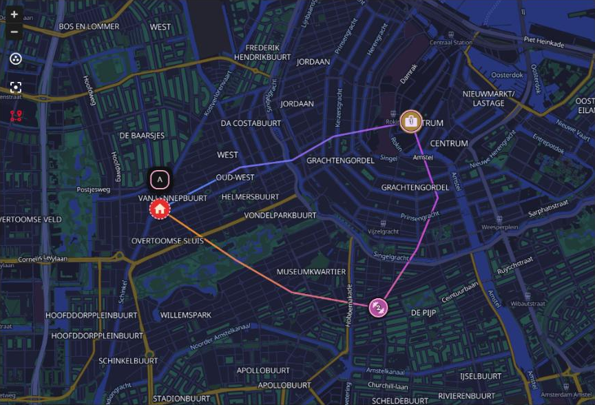

# Map Trail Card

A Home Assistant dashboard card: the built-in map card plus a button that shows or hides movement trails, with the trails cleaned up so stops and direction of travel are readable.



What it shows:

- Everything the built-in map card shows, with the same options.
- A button in the map's button column that turns trails on and off.
- Trails redrawn from the map's own history: one ring per place stopped at, sized by how long the stay was and numbered in order, joined by simplified lines coloured from the start of the trail to the end.
- Every person set up in Home Assistant, each trail in that person's colour.

## Requirements

- Home Assistant 2026.11 or newer. The cleaned trails use internals of the built-in map and were checked against 2026.11.2; see [Known limits](#known-limits).
- People or device trackers that report a location, with history recorded (the default).
- Nothing else: one JavaScript file, no dependencies, nothing loaded from the internet. Map tiles come from wherever the built-in map card gets them.

## Install

### HACS

1. In HACS, open the menu and choose **Custom repositories**.
2. Add `https://github.com/OnticEntia/map-trail-card` with type **Dashboard**.
3. Find **Map Trail Card** in the list and download it. HACS adds the dashboard resource for you.
4. Reload the browser.

### Manually

1. Copy `dist/map-trail-card.js` to `config/www/map-trail-card.js` on your Home Assistant.
2. In **Settings → Dashboards → Resources**, add a resource of type **JavaScript module**:

   ```
   /local/map-trail-card.js?v=1
   ```

3. Raise the number after `?v=` every time you replace the file, otherwise browsers and the companion app keep the old copy.

## Use

Add the card from the card picker ("Map with trail toggle") or in YAML. A minimal example:

```yaml
type: custom:map-trail-card
```

That shows every person with a location and 24 hours of trail. A fuller one:

```yaml
type: custom:map-trail-card
hours_to_show: 12
theme_mode: auto
entities:
  - person.example
  - zone.home
```

## Options

The card takes every option of Home Assistant's `type: map` card and passes them through unchanged. These are its own:

| Option | Default | Meaning |
| --- | --- | --- |
| `hours_to_show` | `24` | Length of the trails while trails are on. With trails off the map gets `0`. |
| `all_people` | `true` | Show every person set up in Home Assistant, including people added later, on top of the entities listed. `false` shows only the listed entities. A person whose phone reports no location does not appear. |
| `trail_cleanup` | `true` | `false` shows Home Assistant's stock trails: one dot per location report. |
| `trail_stop_radius` | `75` | Metres. Reports this close together count as one place. Raise it if one place still shows several stops. |
| `trail_stop_minutes` | `5` | Shortest stay that is drawn as a stop. |
| `trail_zones` | `true` | A fix inside one of your Home Assistant zones counts as being at that zone: the stop is drawn at the zone's centre and its tooltip names the zone. Passive zones are ignored. |
| `trail_number_home` | `false` | Stops at the Home zone carry no number and are skipped in the count, so the first place away from home is 1. `true` numbers them like any other stop. |
| `trail_jitter_radius` | `500` | Metres. Everything this close to a stop is treated as that stop: wandering fixes are dropped and nearby "stops" are folded in. Raise it if one place still shows several rings; lower it to tell apart places that are close together. |
| `trail_max_accuracy` | `150` | Metres. A fix whose reported accuracy is worse than this never bends the line; it can still show that someone is at a place. |
| `trail_tolerance` | `20` | Metres. How far a simplified leg may cut a corner. `1` keeps nearly every report on the line. |
| `trail_colors` | automatic | Left unset: one trail runs blue, magenta, orange; once two or more people have trails, each runs from a pale tint of that person's marker colour to the full colour. A list of two or more hex colours, oldest first, is used for every trail. `entity` always uses each person's own colour. |

There is no visual editor; edit the card as YAML.

## Cleaned trails

Location reports are noisy: a phone lying still reports a cloud of positions, and now and then one far-off fix. The card redraws the trail from the same history the map already loads:

1. **Bad fixes are dropped**: jumps faster than about 250 km/h, and a single fix that leaps away and straight back within ten minutes.
2. **Stays become one stop.** Reports that keep around one spot for `trail_stop_minutes` or longer collapse into one point. A report counts as "around the spot" when its accuracy circle reaches within `trail_stop_radius` of it, so a vague fix far away does not end a stay, and precise fixes decide where the stop is drawn. Trackers go quiet when still, so the silence before the next report elsewhere counts as part of the stay.
3. **Zones are places.** A fix inside a zone's radius is treated as at the zone's centre, judged the way Home Assistant does it (the fix's accuracy circle touches the zone). A stay there is drawn on the zone and named in the tooltip. Two different zones are never folded into one stop.
4. **Each place is one stop.** Anything within `trail_jitter_radius` of a stop belongs to it: stray fixes are dropped and other stops there are folded in. The cost is that two real places closer together than that show as one, and a short walk that stays inside it is not drawn.
5. **Legs between stops are simplified**, so a straight road is one line, not twenty dots. Vague fixes are left out of legs.

How it is drawn:

- **Line colour runs from the start of the trail to the end**, spread over the distance travelled: blue, then magenta, then orange when one person has a trail.
- **With two or more people, each trail is in that person's marker colour**, pale at the start and full at the end (dark at the start on a light map). Every ring is outlined in its person's colour.
- **A ring marks each place stopped at; a bigger ring is a longer stay.** Hover over a ring for the times, or tap it to keep them open; tap again or tap the map to close.
- **Stops are numbered in the order they were visited**, per person; the highest number is the latest. Stops at the Home zone are left unnumbered and not counted. Visits to the same place share one ring: home at the start and end of the day reads `1·4`, and the tooltip lists each visit. A place visited more than twice shows the first two and a count, such as `1·4+2`.
- **A dashed ring marks where the trail starts.** The end is the entity's own marker.
- Nothing else is drawn on the line: no dots along a leg or in the middle of a ring.

Stay times are estimates: the history only records when a report arrived, not when someone actually left.

## Behaviour

- The toggle sits in the map's own button column and follows the map's colour rule: white on a dark map, black on a light one, the theme's primary colour while trails are on. With `theme_mode: auto` it follows Home Assistant's dark mode.
- The on/off choice is stored in the browser (`localStorage`, key `map-trail-card:trails`). It is shared by every Map Trail card in that browser, and other cards already on screen pick it up only when they are next rebuilt.
- Toggling rebuilds the map, because the map reads `hours_to_show` only when it starts. Zoom and pan may reset.

## Known limits

- The card reaches into the map card's private parts: `#buttons` in `hui-map-card` for the toggle, and `_drawPaths` / `_engine.addPath` / `_engine.addMarker` in `ha-map` for the cleaned trails. If a Home Assistant release changes them, the map still works: the toggle goes missing or the stock trails come back, and the browser console shows one `map-trail-card` warning. Last checked against Home Assistant 2026.11.2.
- If the map card cannot be built (for example from an invalid config), Home Assistant's error card is shown and no toggle is added.
- A per-entity `hours_to_show` is not handled; the card-level one drives the toggle.

## Development

- `dist/map-trail-card.js`: the whole card, no build step, no dependencies.
- The version is the `VERSION` constant at the top of the file; it is logged once to the browser console when the card loads. Keep it equal to the release tag.

Check syntax after an edit with `node --check dist/map-trail-card.js`. There are no tests in the repo yet; the trail maths is exposed as `MapTrailCard.trailMaths` for that.

## Licence

MIT, see [LICENSE](LICENSE).
